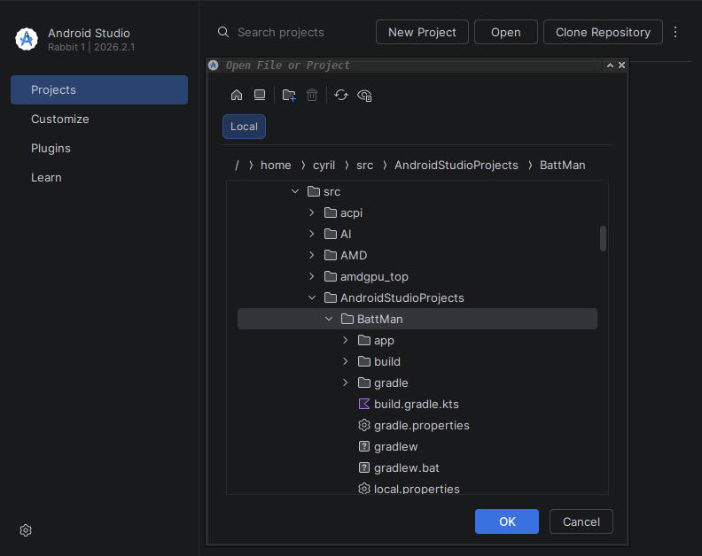
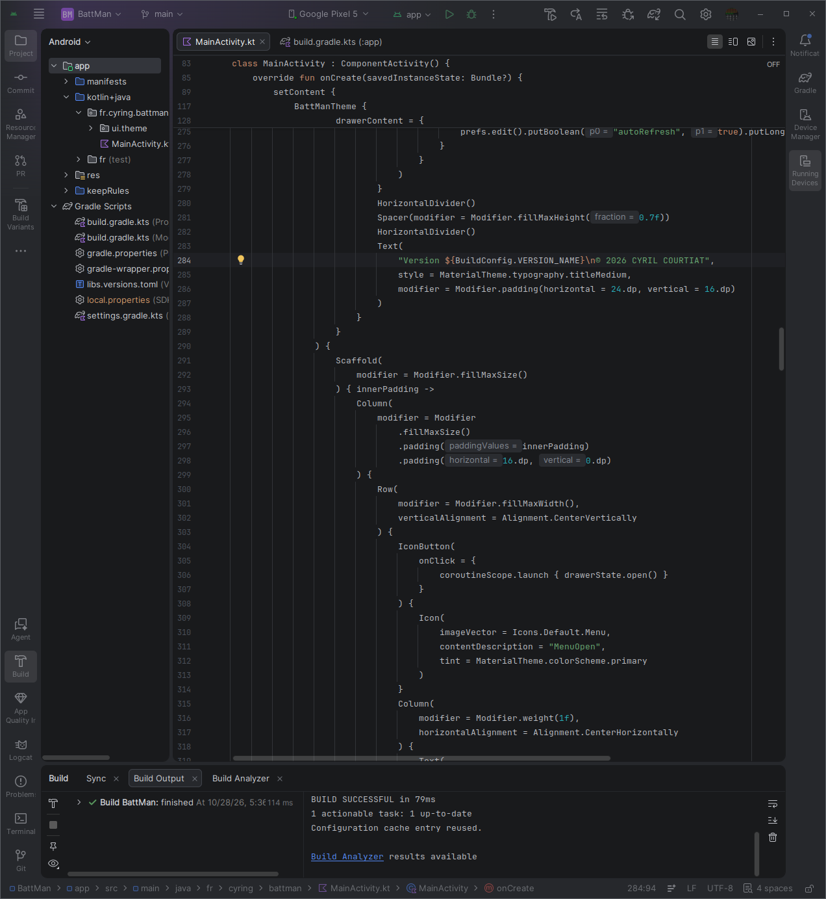

# BattMan
## The Battery Manager

## Build the app
### Android Studio
1. Installation for [ArchLinux](https://wiki.archlinux.org/title/Android#Android_Studio)  
2. Clone/download the **BattMan** app repository  
3. Open the project in Android Studio  

4. Build the source code  
* Go to `Menu > Build > Assemble 'app'`  

## Run the app
### Prepare the smartphone device
* Activate the Developer mode in the Android device  
  From `Settings > About` _tap_ several times the `Build number` link until Developer becomes activated  
  Go to `Settings > System > Developer options` and enable `USB debugging`  
* Plug the device to one USB port of the Android Studio computer  
### Launch the application
* Click the green play button in Studio top bar  
  Or from `Menu > Run > Run 'app'`  
